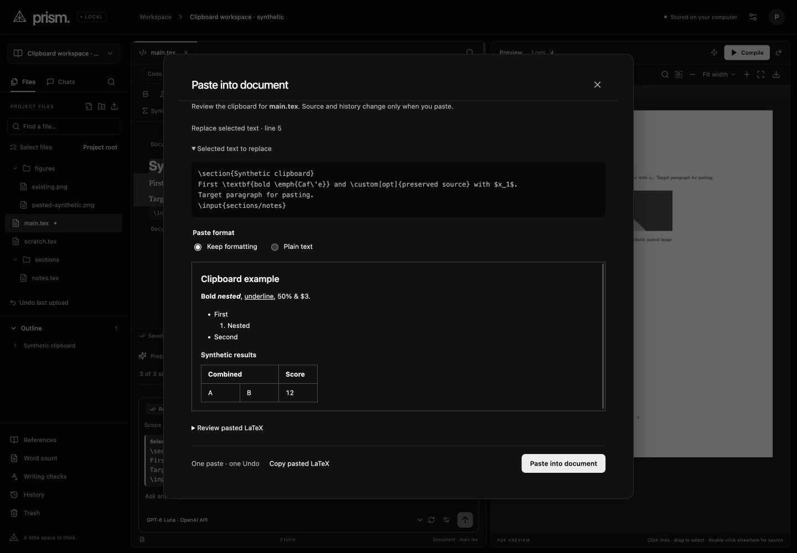
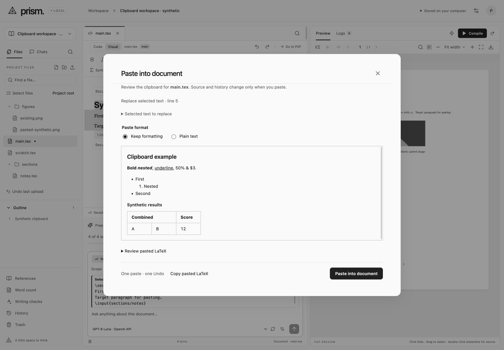

# Clipboard and cross-view read-only verification

Checked 2026-11-01 against Overleaf's official [formatted paste guide](https://www.overleaf.com/learn/how-to/How_to_paste_formatted_content_into_Overleaf) and [table paste guide](https://docs.overleaf.com/writing-and-editing/generating-and-inserting-tables/pasting-tables-into-your-project). These describe formatted text, lists, tables and individual images. Prism's source nonce cache, preview choices and Undo mechanics are independent implementation choices. No Overleaf code or private paper is included.

Ordinary supported formatted paste into Visual mode inserts immediately as one reversible edit. Settings → Editor can require preview first; Paste Preview opens explicit format choices at any time. A pending optional preference question received no answer, so the familiar immediate default was retained. Package requirements, detected formatting losses, missing source records and Code-to-Visual copies require review. The preview captures the file, cursor or selection and exposes both selected and generated LaTeX. It keeps its title/Close control visible while content scrolls. Copy pasted LaTeX remains usable while the source is read-only. Full-document/preamble source belongs in Code view or Document setup; Visual paste refuses nested setup.

Native Prism copies include balanced source and a random opaque identifier. The local backend holds the exact fragment in memory; HTML identifiers never supply trusted raw LaTeX themselves. Code copies preserve source, while Visual copies also expose ordinary HTML/plain text. Copying part of a known style rewraps that style; opaque custom macros/math stay whole. Cut and paste preserve document setup and isolate editor Undo. Source records expire after 30 minutes, clear on restart and are bounded to 64 records/4 MiB, with 256 KiB per copy. They never enter SQLite, project history or ZIP exports. After expiry/restart, the visible clipboard can still be reviewed as formatting/plain text, or explicitly chosen as source.

HTML is parsed without a browser DOM or execution. Supported conversions cover headings, known text styles, safe links, code, quotes, nested lists and bounded literal tables, including horizontal/vertical spans, captions, widths and borders. Active/hidden content is discarded; remote images are never fetched, and unsupported links become text with a warning. PNG/JPEG clipboard images use the existing destination/collision review before upload, then a separate figure insertion. Cancel after upload leaves the asset available and upload Undo remains independent of source Undo. A bitmap accompanying an editable HTML table does not replace the table.

Bounds: 1 MiB HTML, 20,000 nodes, depth 64, 100,000 converted LaTeX characters, four list levels, 100 rows × 24 columns. This is not arbitrary HTML/CSS equivalence: color, advanced layout and unsupported formatting can flatten. Detected unsupported styles, legacy presentation attributes and stylesheets/classes add a warning and force review; package-dependent conversions also always force review before insertion. Nested tables require separate/source editing; complex/multirow table conversion can remain source-only in the table editor. Required LaTeX packages are named, never added/installed automatically. Supported bordered cells follow later column width/alignment edits even when one-column multicolumn declarations override the preamble.

A lightweight indexed activity endpoint returns only active run metadata, separate from chat history and prompts/source snapshots. Every open project view polls it, including open paste dialogs. Other files remain readable/navigable while AI owns source. Paste also rechecks backend read-only state immediately before dispatch; normal backend write locks and source revision checks remain authoritative. When a remote run ends, a clean open file refreshes rather than remaining on an old source version. This is single-user multi-view coordination, not hosted collaboration.

Verification:

- 348 deterministic tests and the production build pass. Clipboard tests cover immutable/expiring bounded records, origins, exports/history exclusion, restart, unsafe/hidden HTML, no remote fetch, escaping, code, spans/borders, bounded input, balanced custom-source copying, document setup, preview policy, exact transaction selection/Undo/Redo and read-only rejection. Activity tests cover indexed filtering, separate conversations/projects, safe full-run recovery, origins and file read-only state.
- `npm run verify:clipboard` passes five real confined pdfLaTeX builds: formatted prose/lists/links/literal code, merged tables/borders/widths/list cells, vertical spans with partial rules, block insertion inside nested heading formatting, and pasted border declarations after a width edit. The installed multirow package was available; nothing was installed.
- Native built-in-browser copy/paste between two views retained exact synthetic source, custom macros and math. Partial bold Copy/Cut/Undo, immediate formatted paste/Undo, HTML table plus bitmap, preview formatting/plain choices and native Shift–Command–V plain paste were exercised. Copy pasted LaTeX matched the full 488-character generated source byte-for-byte.
- PNG-only paste opened the image workflow. Existing asset replacement stayed unchecked; a separately named image uploaded into figures, inserted and compiled. One source Undo recovered exact original text without removing the uploaded asset. A later full-selection formatted replacement/Undo again recovered the exact source.
- A second client changed synthetic source during preview. Paste was rejected and retained the clipboard/source; the external changes survived. A real fixture-server restart cleared nonce records and retained the preview preference. Expired-source fallback remained usable; full-document raw source was disabled in Visual mode with an explicit recovery path.
- An AI preview in one view disabled Paste in another open modal. Local Manual Type fixtures exercised approval, Pause, Resume, Stop, source Undo and inspecting another file while read-only. Native paste into that supporting file changed nothing. No paid generation or private paper was used. The final audit retained main source exactly plus three intentional concurrent-edit comments, unchanged supporting source and zero remote image requests. The earlier pre-restart zero-request audit is retained separately.
- Two bounded IAB inspection rounds covered dark/light 1440×1000, user 997×833 and a configured 560×850 narrow view (actual screenshot rasters 553×839). One image capture was invalid during resizing; the independent reviewer requested and received a settled 997×833 replacement. Narrow checks establish modal containment in the existing desktop editor, not a mobile editor release. No personal browser or external browser automation was used.
- The once-only static changed-target detector was degraded to regex because its own optional parser modules were unavailable. It reported inherited font/accent warnings and existing type/radius/color advisories across the shared stylesheet. This does not certify computed contrast. No URL detector was run.

Ignored evidence: `data/verification/clipboard-*`, `.impeccable/review/clipboard/`. Only synthetic fixtures were used; the owner's port 4317 server remained untouched. An npm dependency audit found seven inherited advisories and none introduced by htmlparser2; this batch does not claim to remediate that separate dependency backlog. The production bundle retains its existing large-main-chunk warning.

The fresh full scoped finish review requested two material corrections: package requirements must force review, and explicit unsupported presentation must be disclosed. Both are implemented, with default-paste regressions and native browser checks while the always-preview preference is off. The same reviewer scored both fixes resolved and returned **ship** for that correction set, validating all eight refreshed captures and both additional fix captures. That verdict does not certify the entire application or establish complete Overleaf parity. The final source audit remains exact after three intentional concurrent edits; no remote image request was made. Remaining local editor and hosted parity gaps stay open.

