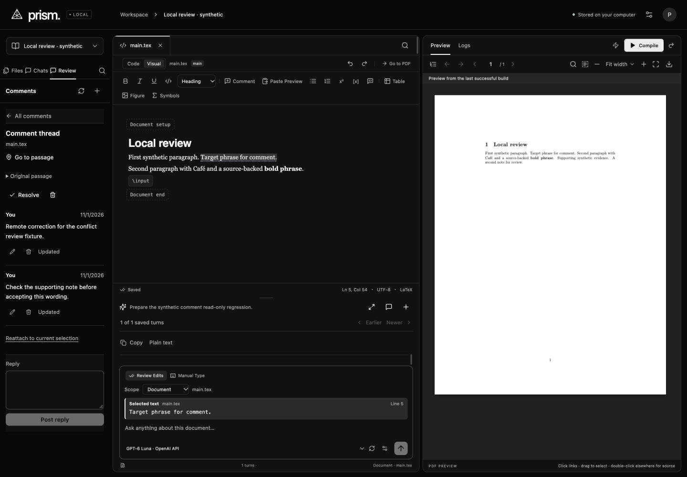
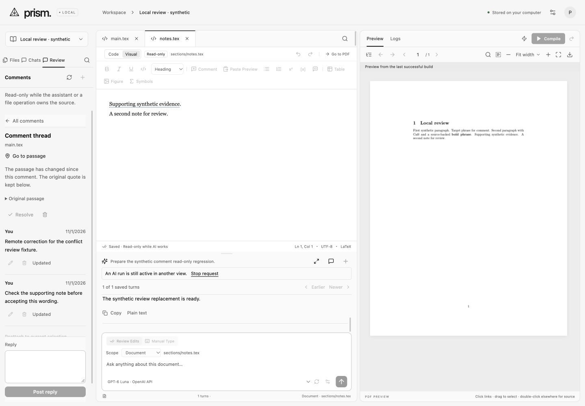

# Local comments — 2026-11-01

Prism implements local source-anchored discussion inspired by the official [Overleaf commenting guide](https://docs.overleaf.com/collaborating/commenting). Selecting a passage, adding a thread, replying, editing messages, resolving and reopening are supported. Review has current-file/whole-project filters and open/resolved/Trash lists. Threads and messages can be restored. The author is always **You** in this single-user release; accounts, shared authors, mentions and notifications remain in the later hosted phase. This is separate from ordinary [tracked changes](https://docs.overleaf.com/collaborating/track-changes), which remain open.

Comments are SQLite metadata. Posting, replying, editing, resolving and restoring do not change source bytes, source Undo, project generation or document-history entries. Source ZIPs and compiler snapshots contain no comment metadata. Copy Project creates independent source with fresh comments; the original discussion remains in its original project. Back up the stopped app's entire `data` directory to retain discussion.

Anchors retain an original quote and map through source edits. Changed or removed passages are labelled explicitly; a user can reattach to a current selection. File moves and their Undo preserve thread identity. A bounded source diff and nearby exact quote/context recovery support source Undo, including incremental Manual Type; ambiguous or large rewrites conservatively require review rather than searching for an unrelated matching passage. File Trash makes a thread's source unavailable without deleting its discussion. A restored file makes it navigable again.

Create/reply identifiers make lost-response retries idempotent. Thread revisions reject concurrent metadata changes; source revisions reject stale new anchors and reattachment. Conflicting message edits retain the local draft beside the current saved body, with an explicit **Use refreshed thread** action before saving. New-comment conflicts retain the body and captured passage for **Use current selection**. Unsent new/edit/reply drafts survive sidebar/thread navigation within the mounted workspace, but not a browser/application restart. Posted data persists. Comments render as escaped plain text, not Markdown or executable source.

Limits: 10,000 UTF-16 code units per body or selected quote, 1,000 threads per file, 10,000 per project, 500 messages per thread, and 50 summary rows per page. Gutter marks load minimal data, full thread bodies load on demand, and overlapping highlights are merged. CodeMirror's decorative gutter is excluded from keyboard focus; **Alt+Enter** at a marked source passage and the accessible Review list provide keyboard access in Code and Visual modes. While AI owns the source, comment mutations and source edits are disabled; discussion, scrolling and other files remain inspectable.

Verification:

- **361 deterministic tests** and the production TypeScript/Vite build pass. Eleven comment tests cover Unicode/range boundaries, changed/removed anchors, bounded rewrites, incremental-typing Undo recovery, metadata/source/history/export isolation, idempotent retries, revision conflicts, recoverable messages/threads, source saves, file move/Undo, restart, file Trash/restore, explicit reattachment, origins, project/path boundaries, AI locks, bounded summaries/markers, 53-thread paging and fresh project copies.
- `npm run verify:comments` passes **three real confined pdfLaTeX builds**: original nested project; after comment/reply/resolution/Trash recovery; and after source edit/Undo with an attached original anchor. Extracted PDF text is identical across all three. No package was installed. Exact source and unchanged history/generation are asserted around comment-only actions.
- Visible Codex built-in-browser checks exercised new threads, replies, message edits and restoration, resolve/reopen, thread Trash/restore, whole-project paging (50+3), cross-file navigation, Code/Visual source selection and keyboard access. An intentional fixture-server restart retained all 53 posted threads and messages. The final stale-draft recovery produced thread 54 without duplicating a failed submission.
- Two browser views exercised conflicting message edits. The local draft and saved body remained visible; Save required explicit rebasing. Distinct unsent message drafts survived switching between messages. A new comment rejected after an external source change retained its exact body and original quote; after undoing that synthetic edit, retargeting and posting succeeded. Final source audit matched both original files exactly, with 54 threads, generation 13 and 9 history snapshots. The history snapshots include intentional source edits and AI boundaries; they are not attributed to comment-only actions.
- Two synthetic local Manual Type runs exercised visible partial insertion, Pause, inspection of another file in read-only mode, Stop and exact source Undo. The confirmation run also restored the original comment anchor automatically. No paid request or private paper was used. The first pass exposed an incremental-typing anchor regression; a saved failing unit case now passes with contextual recovery. The original pre-fix fixture anchor was explicitly reattached through the UI before the confirmation run.
- Two bounded IAB visual passes covered dark/light 1440×1000, the user's 997×833 view and configured 560×850 narrow view (actual captures 553×839). The narrow editor retains the incumbent desktop horizontal-scroll layout; this is not a mobile-editor release. Sticky thread navigation and reply, retained drafts and stale/error states were inspected. All captures carry provenance. No personal browser or external browser automation was used.
- The once-only static changed-target detector degraded to regex because its own optional parsers were unavailable. It reported 106 findings (six warnings, 100 advisories, no errors), mostly inherited shared-stylesheet font/type/spacing choices, plus a new 3-pixel marker-radius advisory. It did not evaluate computed contrast. No URL detector was run.

Evidence stays under ignored `data/verification/comments-*` and `.impeccable/review/comments/`. Only synthetic fixtures were used. The owner's port 4317 server was not restarted. The production bundle retains its existing large-chunk warning. Broader local/hosted parity gaps remain open.

The fresh finish reviewer returned **ship** for all six required captures and the sampled comments implementation, with no material fixes requested. Uncaptured list, Trash, focus and motion states are not visually certified by that verdict; unsampled backend branches are outside its scope. The final design documentation records the built interface and preserves existing editor guidance.

Subsequent [ordinary tracked changes](tracking.md) add the separate local Editing/Reviewing workflow. The comments batch's original statement that this remained open records its release scope.
