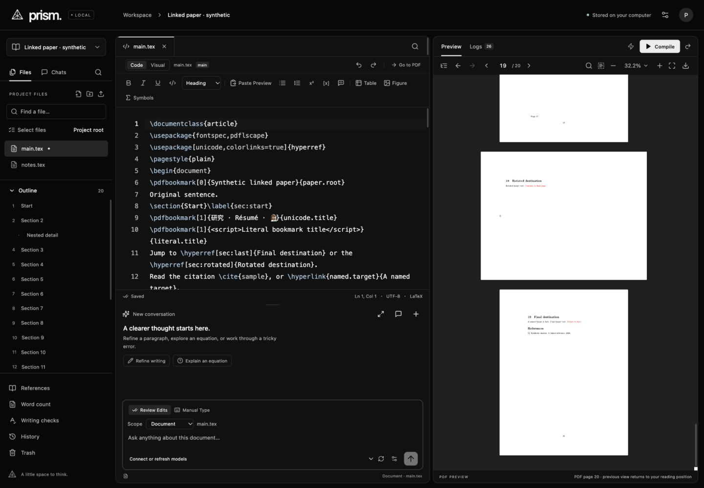

# Dependency maintenance

Updated 2026-11-01. The clipboard batch recorded seven inherited npm advisories. This maintenance change updates the affected dependency tree and checks runtime compatibility; it is separate from the remaining Overleaf feature work.

Installed versions:

| Package | Version | Reason |
| --- | --- | --- |
| @fastify/static | 10.1.8 | Patched static-file dependency; remains compatible with Fastify 5 |
| pdfjs-dist | 6.4.299 | Uses the patched PDF.js release line |
| glob | 14.0.3 | Scoped override under @fastify/static; resolves the cancellation advisory |
| minimatch | 11.0.3 | Supplied by glob 14; resolves the reported pattern-amplification advisory |
| katex | 0.19.1 | Reuses the existing patched root renderer for micromark-extension-math |

The official [static-plugin compatibility table](https://github.com/fastify/fastify-static#compatibility) supports Fastify 5. The [PDF.js advisory](https://github.com/mozilla/pdf.js/security/advisories/GHSA-hq66-cqwq-w95j) lists 6.2.108 as patched and describes scripting-dependent impact; a dependency advisory is not evidence that Prism's canvas integration exercised the vulnerable scripting path. The [glob advisory](https://github.com/isaacs/node-glob/security/advisories/GHSA-3g3m-2fjr-6pw4) lists 14.0.2 or later as patched, and the [minimatch advisory](https://github.com/isaacs/minimatch/security/advisories/GHSA-g3hv-75wg-m249) lists 11.0.1. The [KaTeX advisory](https://github.com/KaTeX/KaTeX/security/advisories/GHSA-238p-pmpm-9mq7) affects versions before 0.18.2. The app already used KaTeX 0.19.1 directly; the override removes the separate old transitive copy. No forced audit downgrade or broad dependency upgrade was used.

Verification:

- `npm audit --json` reports zero known advisories for the installed tree. This is registry dependency evidence, not a repository-wide security assessment.
- The production build and all 350 tests pass. New compatibility cases exercise UTF-8/space-containing static asset paths, final-path denial, encoded traversal attempts, static route enumeration through the glob override, SPA/API routing, and loopback/origin guards.
- A clean `npm ci --ignore-scripts --no-audit` in an ignored fixture reproduces the same versions and deduplicated KaTeX without invalid override entries. A normal fresh install still follows the README's npm commands.
- A real confined XeLaTeX build produces the synthetic 20-page linked/rotated document. No TeX package was installed.
- Codex's built-in browser renders the canvas and selectable text layers, follows an internal link to page 20, finds a unique match across all pages, copies all extracted text (1,936 characters including first/final/rotated pages), changes zoom and navigates to the landscape page. Nested Unicode and literal-markup bookmark titles remain readable. The project library's actual PDF thumbnail renders at 280×363 pixels.
- Exact source bytes for both synthetic files and the project generation remain unchanged after browser checks. No paid request or private paper was used. Native PDF drag-selection and native fullscreen were not repeated in this maintenance pass; their earlier evidence remains scoped to their original versions.

Ignored evidence: `data/verification/dependencies-*`, `.impeccable/review/dependencies/`, and the linked fixture root named in `data/verification/dependencies-fixture.json`. Browser work used an isolated port 5173 server; the owner's port 4317 process was not restarted. No frontend layout or control code changed.

The comments/tracked-changes gap remains open. The official [comments guide](https://docs.overleaf.com/collaborating/commenting) describes anchored threads, replies, resolution, editing and reopening; [Track Changes](https://docs.overleaf.com/collaborating/track-changes) describes explicit Editing/Reviewing modes and selected-range Accept/Reject. Hosted sharing and notifications remain in the owner-selected later phase. The tracking-default question is unanswered; an explicit opt-in toggle is the current implementation assumption, separate from always-on automatic history.

