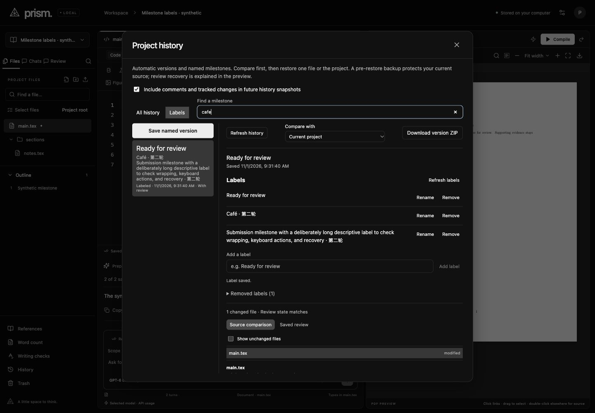
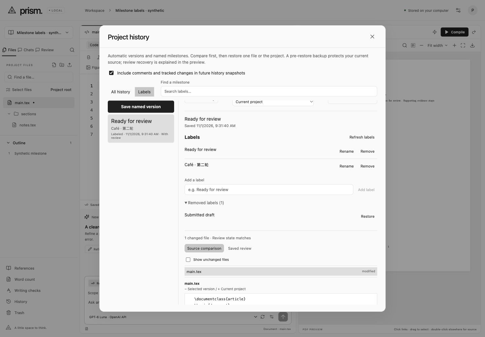

# Multiple history labels · 2026-11-01

Saved versions now support multiple milestone labels, an **All history / Labels** view, and case/accent-insensitive label search. The official [history guide](https://docs.overleaf.com/writing-and-editing/history-and-versioning) documents multiple labels per version and a Labels view. Prism's search, recoverable removal, limits and retry controls are independent implementation choices. Full Overleaf parity remains an active objective.

Labels annotate an immutable version. Adding, renaming, removing or restoring a label never changes source, source Undo, compiler input, saved review, generation or chat identity, and does not schedule another checkpoint. The first active label supplies the version's display name; all active names remain inspectable. Existing named milestones migrate once, preserving their stored snapshot bytes. Automatic versions start unlabeled. Removing every label does not remove the saved version; it remains in All history. Copies start with fresh history and no inherited labels.

Removed labels keep their IDs, names and timestamps under **Removed labels** and can be restored. A new name cannot duplicate an active canonical/case-insensitive name on the same version; other versions may reuse it. Rename and removal require the current metadata revision. Stale requests preserve the draft, explain the conflict and require Refresh labels; refresh keeps the local text. An ambiguous response retains its operation UUID for **Retry label action**. Replaying the same signed request after restart or later changes never overwrites newer names. A reused identifier with different content rejects.

## Verification

**406 deterministic tests and the production TypeScript/Vite build pass.** Sixteen new tests cover migration/no resurrection; complete source/review/generation/history isolation; label-only scheduling; Unicode/case duplicates and restoration conflicts; restart/replay/later changes; stale revisions/scoped IDs; malformed/control/normalized-length validation; AI locks/project Trash; transaction rollback and failed initial checkpoint-label persistence; active/retained bounds; non-destructive legacy PATCH; label-aware restore display with unchanged immutable token; fresh project copies; search; and API origin/header/metadata boundaries.

The first focused run caught a normalized Unicode name whose length expanded beyond the raw 120-unit check. Validation now checks normalized length too. A test expected the wrong existing file-lock wording and was corrected to accept the actual typing-lock message. Both defects were resolved before the passing full suite. The label revision check, mutation and replay journal are serialized in one database transaction, and checkpoint seeding uses a savepoint so an initial-label persistence failure cannot leave a partial version.

`npm run verify:history-labels` passes **two real macOS-sandboxed pdfLaTeX builds**: a synthetic multi-file document before label changes, and identical source after add/rename/remove/restore/replay. Exact active file bytes, immutable checkpoint payload, source generation and history count remain unchanged; extracted PDF text matches. No TeX package was installed. Logs remain ignored under `data/verification/history-labels-tests.log`, `history-labels-build.log` and `history-labels-compile.log`.

Only Codex's visible built-in browser drove UI checks, against a separate synthetic port-5173 fixture. The owner's running port-4317 server and private papers were untouched. Browser checks added a Unicode second label, renamed the first, removed/restored a name, searched Café through `cafe`, exercised an empty filter, and prepared/cancelled a file restore whose displayed label and immutable version were correct.

A synthetic successful label save deliberately returned 503 after commit. Retry reused the retained request and recovered the one saved label. A later recoverable removal increased the action count from four to six, not seven. Exact source, generation 1 and the three original snapshot payloads remained unchanged through that phase. Another browser view renamed the milestone while the first held an unsent draft. The stale submission rejected; Refresh kept the exact local draft and made it editable against the newer revision. Active and removed labels survived a real backend restart. A long multilingual label wrapped within the timeline and manager.

Two local stub Manual Type requests reused one conversation. The first draft left source/history unchanged and was discarded. The second was approved, paused, resumed to visible partial insertion, paused again, and stopped. Another file remained viewable but rejected typing. During the paused run, label metadata refresh and inspection remained available while Add/Rename/Remove/Restore were disabled; the server lock is also tested. One-step typing Undo restored both files byte-for-byte. The final read-only audit confirms all three original snapshot payloads unchanged, exact original source, label revision 9/nine operations, three active labels and one recoverable removed label. Generation 4/six history entries include deliberate AI partial edits, boundaries and Undo. Both runs are stopped and share one conversation. The isolated server and its browser tabs were closed after verification, and the viewport override was reset. No paid call or live provider/CLI generation was made.

Audits remain ignored under `data/verification/history-labels-first-audit.json`, `history-labels-retry-audit.json`, `history-labels-draft-audit.json` and `history-labels-final-audit.json`. A verification-helper prototype mismatch between SQLite rows and JSON objects was corrected without changing application behavior.

## Visual evidence and boundaries

Two bounded builder rounds covered 1440 × 1000 desktop in both themes, the user's 997 × 833 panel and a configured/DOM 560 × 850 narrow viewport, captured proportionally at 553 × 839. Dark/light, long names, removed recovery, stale drafts, ambiguous responses, keyboard Save/Cancel and paused-AI read-only states were inspected. No material UI correction was found between these builder rounds. The history dialog retains bounded internal scrolling and its fixed heading/Close control; the incumbent editor behind it keeps its desktop minimum width and horizontal pan, rather than becoming a mobile editor.

All captured rasters have embedded built-application/synthetic-fixture origins under ignored `.impeccable/review/history-labels/`. Shipping images below copy the validated desktop captures. The static detector ran once on changed targets, degraded to regex because optional parser modules were unavailable, and did not evaluate computed contrast. It found six inherited warnings and 101 advisories. The one new advisory is the intentional 16px narrow input size, satisfying the mobile input floor rather than inheriting the smaller desktop control size. No tool-environment repair or detector rerun was performed. The fresh finish reviewer returned **SHIP** with no material fixes across the eight required captures and sampled label implementation. Full App/routes/recovery code, test bodies, build log, external documentation and uncaptured states were outside that review. The final documenter records the delivered label controls and intentional narrow input size; these handoffs do not establish full application or Overleaf parity, motion certification or unsampled backend correctness.

## Limits

Names are limited to **120 UTF-16 units after NFC normalization**, trimmed and collapsed to single spaces, with control characters rejected. Each version retains at most **100 active / 500 total labels**, including recoverable removed labels. At the retention bound, rename or restore existing metadata; no permanent purge was added. Search includes every active name and never silently changes the selected source version. The timeline previews three names plus a remaining count; bounded lists expose the rest. Version listings still scale with project history, so these checks do not establish maximum-size responsiveness.

Label-only changes are separate from review-history snapshots and are not undone by restoring source/review. They do not recover historical label names from before this feature existed. The legacy single-name PATCH appends safely instead of overwriting existing labels; modern clients use revision-bound actions. Unsent label drafts and pending request IDs live in the open history dialog; restart retains committed labels and operation journals, not an unsent draft. Existing normal project/data backup guidance remains applicable. Other local editing and hosted-collaboration gaps remain in the parity ledger.
