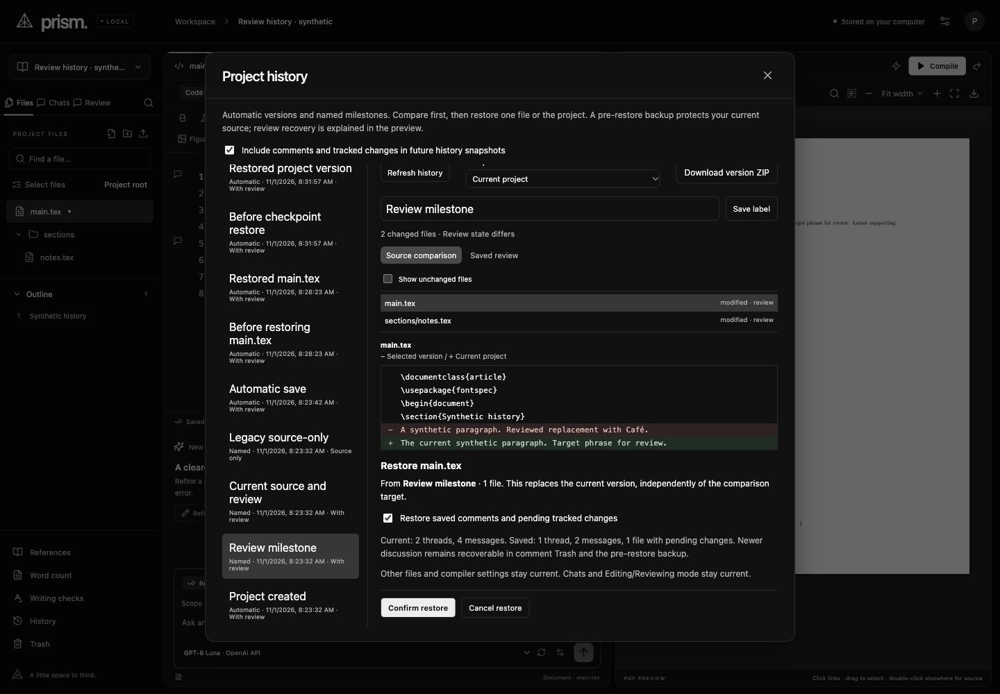
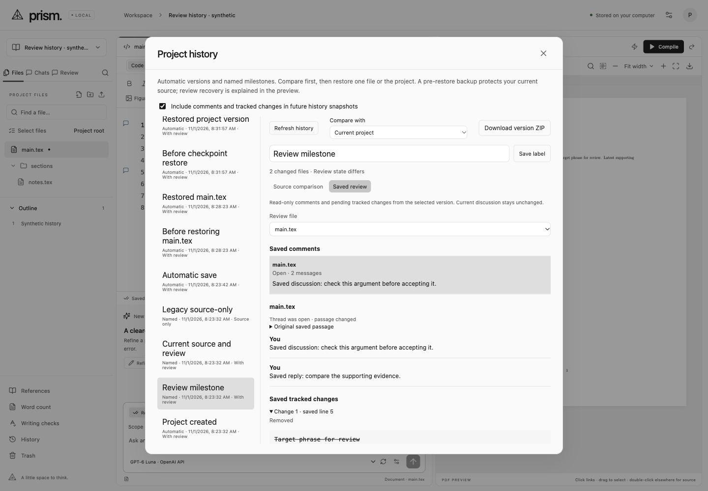

# Review state in history · 2026-11-01

History now saves bounded local comments and pending tracked changes with source versions. The owner confirmed **Include review state in history**. The per-project capture checkbox is enabled by default and changes future captures; it does not remove older saved metadata. Source tracking itself remains opt-in through Editing/Reviewing.

This addresses the file/project restoration scope in the official [history and versioning guide](https://docs.overleaf.com/writing-and-editing/history-and-versioning): restoring the selected scope also restores its saved comments and tracked changes. The guide documents historical source ZIP downloads and multiple labels per version. Prism still has one label per version; historical PDF association is a separate enhancement, not an established requirement from that guide. Hosted collaboration remains deferred and full Overleaf parity is not claimed.

## Delivered behavior

- Automatic checkpoint identity includes review content. A comment edit or Accept decision can create a grouped version without changing source bytes or source generation. Review bodies use deduplicated, hash-verified blobs, independent of source blobs.
- The timeline distinguishes **With review** and **Source only**. **Saved review** reads archived discussion and pending before/after LaTeX without changing current discussion. Summary pages contain 25 threads; complete message bodies load on selection. Review-file selection also selects the file to restore.
- Restore first prepares a concrete preview with file/project scope, current/saved counts and a review-inclusion choice. Confirmation checks source revision or project generation and, when replacing review, the exact live review token. Source/review changes after comparison require refreshing. Lost-response retry uses the same operation UUID and does not apply twice, including after restart or later source edits.
- Single-file restore preserves other files and compiler settings. It recovers that file's saved review. If a saved discussion is now in another file, stable scoped copies preserve the current original and avoid repeated-copy duplication. Newer threads and messages remain recoverable in comment Trash and the pre-restore backup.
- Whole restore recovers saved source, main-document/compiler settings and included review. Current chats, credentials and the current Editing/Reviewing preference stay current. Pending baselines are restored without recursively tracking the recovery operation.
- A pre-restore version backs up current source and attempts review capture even when future capture is disabled. Recovery and its idempotency journal share the source/review transaction. Restoring an older/source-only version instead retains live review, rebases comments and follows the current tracking mode.
- During AI work, history remains inspectable while restores and capture-setting changes are disabled and server-rejected. The dialog retains its heading/close control, scrolls source/archive content internally, focuses new confirmation/error content and keeps recovery feedback with its controls.

## Automated and compiler evidence

**390 deterministic tests pass**, including the existing provider, Manual Type, source/history and confinement suites. The production TypeScript/Vite build passes. Vite retains its non-failing large-main-chunk warning; this batch does not establish a performance benchmark.

New coverage includes comment-only history, capture-off/restart, deduplication and read-only comparison without persisting hidden review blobs; exact whole/file recovery; stable copies of moved discussion and reply order; legacy fallback; source/review conflicts; unrelated-file concurrency; replay after restart/later edits; forced pre-restore review backup; corruption and atomic rollback; size-limit omission without live-review loss; origin/path/AI locks; archived summaries/details; semantic comparison that ignores administrative timestamps/revisions; and 28-thread paging as 25 + 3 without omissions.

`npm run verify:review-history` passes six real confined pdfLaTeX builds using installed tools:

| Build | Expected result |
|---|---|
| Saved source with pending review | Saved wording and saved supporting file |
| Latest source/review | Current wording and latest supporting file |
| Single-file restore | Saved main file with latest supporting source and discussion |
| Pre-restore backup recovery | Exact current source and review |
| Whole-version restore | Exact saved source and review |
| Latest-version recovery | Exact current source and review again |

Extracted PDF text agrees for saved/whole-saved and for current/backup-recovered/current-again. The hybrid differs from both as intended. Source entry points remain byte-exact. Current source compiles independently of review marks. No TeX package was installed. The outer tool sandbox initially prevented nesting `sandbox-exec`; rerunning with the outer restriction lifted retained Prism's own deny-default compiler profile and passed.

Ignored logs: `data/verification/review-history-tests.log`, `review-history-build.log`, `review-history-compile.log`. The portable synthetic compiler verifier is committed under `scripts/verify-review-history.ts`.

## Built-in-browser evidence

Only Codex's visible built-in browser drove UI checks, against an isolated synthetic server on port 5173. The owner's running port-4317 application and private papers were untouched.

Saved review displayed the older two-message discussion and pending Unicode replacement separately from current discussion. A scoped `main.tex` restore deliberately lost its successful response; the retained confirmation retried and recovered one operation, not two. A read-only SQLite audit confirmed saved main bytes, unchanged latest supporting bytes/discussion, recoverable newer main discussion and one newly applied restore. Recovering the pre-restore version restored exact original current source/review. A real legacy source-only restore preserved current discussion and pending state.

A second view edited a current comment after the first view prepared a restore. Confirmation rejected the stale review token and retained the new comment. Refreshing and deliberately restoring the named current version recovered the fixture exactly. Current source generation need not change for a comment conflict to be detected. The future-capture checkbox remained off after a real backend restart, then was explicitly re-enabled.

Two stub Manual Type requests reused one conversation. The first draft was discarded; the second draft left source revisions, history count and review unchanged before approval. After Start, a visible insertion was paused; another file remained selectable but rejected typing, and archived history stayed readable with mutation controls disabled. Stop preserved the visible partial edit. One-step typing Undo restored both original files byte-for-byte, verified from the subsequent pre-restore snapshot. Final named recovery matched the original comment semantics and zero pending files while preserving the current Reviewing preference. Both saved runs are stopped and belong to the same conversation. The fixture server and its two browser tabs were closed after checks, and the temporary viewport override was reset. No live provider/CLI test or paid call was made.

Ignored audits: `review-history-file-audit.json`, `review-history-current-audit.json`, `review-history-draft-audit.json`, `review-history-second-draft-audit.json`, `review-history-run-audit.json`, `review-history-final-audit.json` under `data/verification/`. The final audit records exact current source/review, main revision 12, supporting revision 6, seven applied restores, 24 checkpoints, zero pending files and enabled Reviewing at review revision 16. Those counts include deliberate source changes, capture-policy changes, recovery backups and AI boundaries.

## Visual review

Two bounded builder rounds covered 1440 × 1000 desktop in both themes, 1004 × 844 concurrent-error evidence, the user's 997 × 833 panel, and a configured 560 × 850 narrow viewport. Full narrow capture includes the inherited 650-pixel desktop shell; a separate viewport capture (proportionally recorded at 553 × 839 pixels) confirms the dialog’s actions fit the configured viewport. The surrounding editor retains horizontal pan and is not a mobile redesign. Captures are origin-embedded under ignored `.impeccable/review/review-history/`.

The first round exposed a scrolling-away title, below-fold confirmation and distant error feedback. One correction batch bounded the dialog's internal scrolling, retained the header, focused prepared recovery content and placed errors beside confirmation. It also corrected singular/plural counts, source-only fate copy and pre-restore backup names.

The static detector ran once on changed UI targets. Optional parser modules were unavailable, so it fell back to regex and did not evaluate computed contrast. Its six warnings and 100 advisories refer to inherited global stylesheet regions; none is in the added history region or changed TSX/index. The tool environment was not altered or the detector rerun.

The fresh finish reviewer validated all eight supplied captures, found no material UI correction at the sampled history/archive scope, and requested one documentation reconciliation of obsolete source-only-history statements. The fresh documenter reconciled the design notes and sidecar; the verdict pass scored that single documentation fix resolved and returned **SHIP** at that correction scope. This review does not certify uncaptured motion, all backend integrations, unrelated application regions or full Overleaf parity.

## Boundaries and recovery limits

Review capture includes recoverable deleted metadata and is limited to **16 MiB**, **10,000 threads**, **50,000 messages** and **10,000 tracked files**. When capture cannot fit, source is saved with an explicit omission reason and live review remains intact. Old, absent or corrupt saved review offers source-only recovery; unavailable saved metadata cannot be reconstructed. A pre-restore backup uses the same limits, so the preview must not promise unlimited review backup.

Restoring older review does not permanently erase newer discussion. Extra recoverable Trash means an older version is not a byte-for-byte copy of the entire database. Single-file moved-thread copies use stable derived IDs; current per-file comment limits can reject creation rather than silently discard discussion. Source-only restoration can create pending text changes when current Reviewing is enabled.

History does not restore chat state, credentials, current tracking mode or historical review-decision Undo journals. Existing source restore advances file revisions/generation even for identical content. There is no automatic checkpoint pruning; review blobs add local storage. Abrupt termination can lose an unflushed grouped version, while ordinary autosaved revisions remain. Power-loss durability, maximum-size transport stress, sustained native fullscreen, live provider compatibility and shared multi-author history were not established by this batch.
