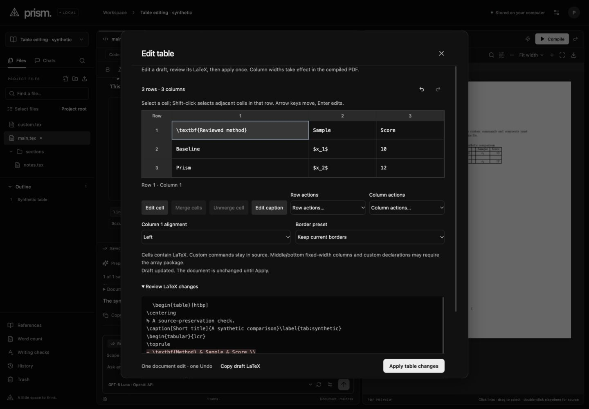
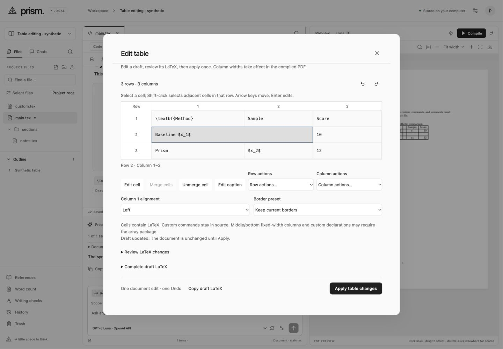

# Existing-table drafts

This local editing extension follows the scope of Overleaf's official [table editor guide](https://docs.overleaf.com/writing-and-editing/generating-and-inserting-tables/edit-or-customize-an-inserted-table) and [column width guide](https://docs.overleaf.com/writing-and-editing/generating-and-inserting-tables/set-the-width-of-table-columns), checked on 2026-11-01. These document cell editing, row/column operations, horizontal merging, borders and widths, with source editing for complex tables. Prism implements an independent bounded parser; no Overleaf code or private project content is included.

Code's Table action edits the table at the captured cursor or inserts a new table elsewhere. Visual mode retains exact cell-fragment editing and adds Edit table. The modal holds a local draft: opening, selecting, changing cells, structural operations and draft Undo/Redo do not save source or add project history. Apply replaces one captured table, rechecks current file/source/revision and uses one isolated CodeMirror transaction. The normal revision-checked autosave and automatic history then apply.

Supported: literal tabular structures with l/c/r/p/m/b columns, preserved declaration groups, up to 100 rows, 24 columns and 100,000 source characters. Cells and an existing direct-float caption accept LaTeX. Horizontal merges retain content and outside literal borders; unmerge keeps content in the first cell. Column changes and border presets require unmerged cells; partial-width rules block those operations. Fixed widths affect the compiled PDF, not this schematic grid. Array/booktabs dependencies are explained and never installed automatically.

Source-only boundaries: repeated/custom column types, tabularx/tabular*/longtable, nested cell environments, multirow/verbatim structure, and custom caption placement/labels. Caption insertion, removal, repositioning and reference updates remain source operations. Unsupported syntax is kept intact and can open the existing source editor. No TeX macro expansion or imported scripts run in the browser.

Verification:

- 325 deterministic tests and the production build pass. Ten table tests cover byte preservation/CRLF/comments/Unicode, cell boundaries, rows/columns, widths, merged offsets, borders, captions, conservative fallback and exact transaction Undo/Redo with selection.
- `npm run verify:tables` compiles three synthetic cases using the application's existing sandboxed compiler: combined cell/row/column/width/grid/caption changes, merged cells and a final unterminated row with booktabs. All passed, including the rerun after comment preservation was corrected.
- Built-in-browser checks cover Code/Visual entry, cell update/invalid input, row/column insertion, widths, borders, merge/unmerge, draft Undo/Redo, caption editing, source diff and one Apply/Undo. The browser-triggered edited table compiled successfully. Saved source was byte-identical after Undo and fixture-server restart.
- A second client changed the synthetic source while a caption draft was open. Apply was rejected with the draft still visible; external changes survived. Repeated-column fallback opened the exact original source with Apply disabled until an edit.
- Local synthetic Manual Type runs exercised preview approval, Pause, table inspection with all mutations disabled, switching to a supporting file, Resume and one-step Undo. The target returned to its exact prior bytes, and the supporting file stayed unchanged. No paid provider request was made.
- Two bounded visual passes covered 1440×1000 desktop, the user's 997×833 view and configured 560×850 narrow view in both themes. Narrow evidence establishes dialog containment inside the existing desktop shell, not a new mobile editor. Two resize-transition captures were invalid and replaced with settled captures.
- The one static detector pass was degraded because its optional HTML parser modules are unavailable. It reported inherited warnings/advisories in the wider changed files, with no finding in the added table rules. It does not certify computed contrast or interaction. No URL/browser detector was used.

Ignored local evidence: `data/verification/table-*`, `.impeccable/review/tables/`. Only synthetic content was used. The owner's running 4317 server and private papers were untouched. Finish review and corrections are recorded below. Remaining parity-ledger gaps stay open.

The fresh finish review requested two corrections: normalize selection after merge/unmerge/history changes, and make stale-draft recovery copy the complete raw LaTeX before close/reload. Both are implemented. A new selection regression passes, and built-in-browser merge/unmerge/Undo/Redo shows only the intended merged cell selected with Merge disabled. Native Copy → close → paste matched the complete 294-character draft byte-for-byte. The same seven viewport/state captures were refreshed for the reviewer’s verdict. A repeated paused-lock/Stop/Undo fixture again recovered exact source. No second detector was run.

The reviewer returned **ship** after scoring both requested fixes resolved and validating all seven recaptures. That verdict covers the two corrections; it is not a claim of full app or Overleaf parity. The earlier full scoped review and final fix verdict are retained in the ignored review evidence.

