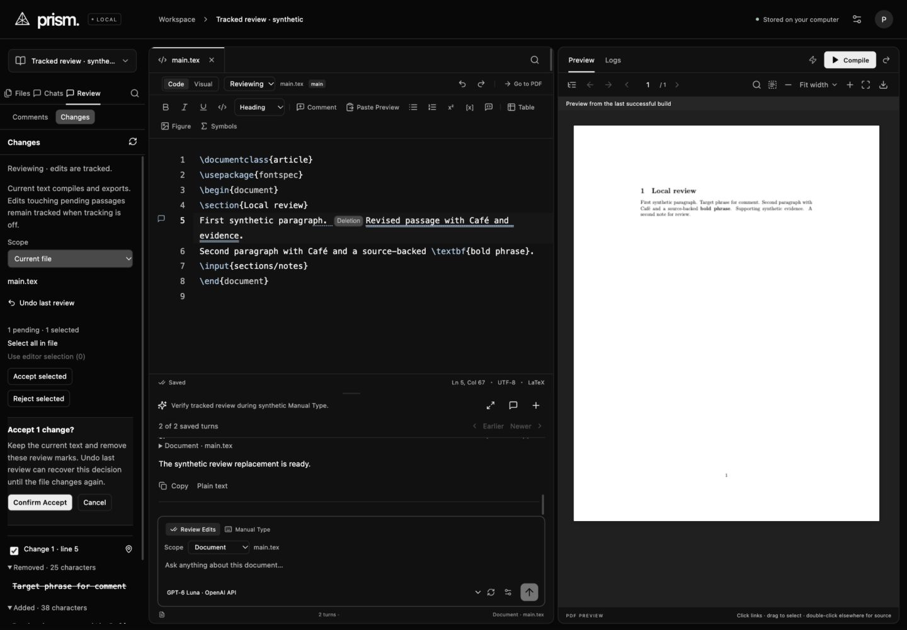
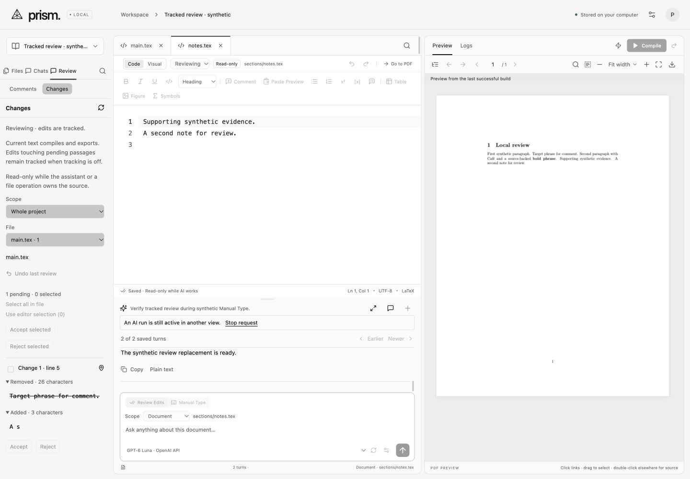

# Ordinary tracked changes — 2026-11-01

Update, 2026-11-01: the subsequent [review-history release](review-history.md) adds optional saved comment/pending-change snapshots and restoration. Its owner-confirmed default includes review. The original evidence below describes the earlier release; statements about review metadata staying outside document history are superseded. Source bytes, source Undo, compilation and source ZIPs remain separate from review metadata.

Prism adds opt-in local source review, following the documented [Editing/Reviewing and selected-change workflow](https://docs.overleaf.com/collaborating/track-changes). The owner selected local-first development; hosted collaboration remains later work. No answer to the earlier tracking-default question was received, so explicit opt-in is an implementation assumption, not an owner-confirmed default. Automatic history stays enabled independently.

Choose Reviewing beside Code/Visual to track writes to existing text files in that project. Review → Changes shows complete removed/added source with individual actions and checkbox selection. Editor selection includes each intersecting review passage in full; pure deletions are also selectable through the list or Select all in file. Accept keeps current source and removes the corresponding marks. Reject restores earlier source. Both require an explicit confirmation. Whole project chooses a file to inspect; a decision covers one file, not an implicit project-wide batch.

Current source remains authoritative for compilation, source ZIP export and project copies; review decorations never become LaTeX. Copies contain the current text with fresh, disabled tracking. This matches the documented copy behavior at the text level, without claiming Overleaf's hosted permissions or author attribution. New file creation and file deletion remain file-history/Trash operations rather than text review. Existing-text replacements, source tools, Visual edits, approved AI changes, history restores and reference rewrites pass through tracking when enabled. File moves and move Undo retain pending review paths. A file in Trash retains its pending review but must be restored before a decision.

Turning tracking off does not silently accept earlier changes. Disjoint new edits update accepted text; edits touching an existing pending passage continue that review. Nearby edits separated by at most 12 unchanged UTF-16 units without a line break form one coherent passage. The original first browser pass exposed excessive character-level fragments and repeated deletion chips; the correction groups them while preserving exact source. This grouping is Prism's review unit, not a claim of identical Overleaf grouping.

Review metadata uses additive SQLite tables for project mode/revision, accepted file baselines and review-operation journals. It survives restart, stays outside source exports/compiler snapshots and is included in a complete stopped-app `data` backup. Accept and mode changes do not modify source generation or source-history entries. Reject writes a normal file revision, rebases comment anchors and preserves an automatic history boundary. **Undo last review** restores both source and pending baseline, subject to exact source/revision/baseline checks. Later edits can invalidate this dedicated Undo; History remains available for source inspection. Ordinary typing Undo/Redo changes source normally, with net changes reflected in review. The review journal is not a multi-author activity feed.

Requests bind project review revision, file source revision and a SHA-256 token of the exact hunk layout. A timeout-dependent grouped fallback therefore cannot be mistaken for an earlier detailed plan. UUID/signature replay prevents duplicate decisions after lost responses; changed or reused requests fail before overwriting source. Conflicting confirmations retain the captured decision and visibly disable confirmation until refreshed. Active AI reservations reject mode/review/Undo changes in the backend. Reading, scrolling and file navigation remain available. CodeMirror keeps selectable source while its transaction filter enforces read-only state; `contenteditable=true` alone is not evidence that source edits are permitted.

Bounds: editable source is 2 MB per file. Grapheme-aware diff work trims unchanged edges; a changed window above 200,000 units, 40-ms diff budget, 20,000 edit distance or more than 1,000 raw hunks yields one exact grouped passage. Large before/after text remains available in scrollable disclosures. Rejecting into more than 2 MB fails with a smaller-selection recovery message. Source marks use double underlines plus a compact deletion indicator; complete removed text stays in review rather than crowding the document. Alt+Shift+Enter and the Review list provide keyboard access in Code and Visual modes. Narrow views retain the incumbent horizontally scrolling desktop shell, not a mobile editor.

Verification:

- **374 deterministic tests** and the production TypeScript/Vite build pass. Thirteen tracking tests cover whole-grapheme Unicode ranges, exact reconstruction, selected Accept/Reject, bounded rewrites, coherent grouping, untracked edits around pending passages, opt-in/persistence, fresh copies/export isolation, source/history invariants, persistent review Undo, comment-anchor recovery, stale source/review/token rejection, duplicate identifiers, incremental typing/net Undo, file moves/Trash and HTTP origin/path/AI-lock checks.
- `npm run verify:tracking` passes **five real confined pdfLaTeX builds**: original multi-file document; tracked current source; accepted current source; rejected original source; Undo Reject returning to current source. Extracted PDF text agrees for original/rejected and for tracked/accepted/Undo Reject, with the two versions differing as intended. The entry file stays byte-exact; Accept leaves source/history unchanged. No package was installed.
- The isolated browser fixture restarted once to load the correction batch. Reviewing mode and pending source persisted. Native UI checks covered individual Accept, selected-range and whole-file decisions, Cancel, Reject, dedicated Undo, source Undo, Code/Visual navigation, keyboard review access and mode-off retention.
- Two views exercised an external source change while a confirmation was open. Confirm became disabled with an explicit stale notice; the pending action did not overwrite the external source. Undoing that external edit and refreshing/source navigation recovered a valid review.
- Two local AI fixture turns reused one saved conversation. The first paused, resumed to natural completion, then one-step typing Undo restored the source and cleared review. The second ran at 0.5×, paused with four inserted characters, then Stop retained those characters; one-step Undo again restored original source and cleared pending review. A supporting file remained readable; a native typing attempt was blocked and its text stayed unchanged. Source mode and review actions were disabled in the other view. No paid/provider request or private paper was used.
- The pre-fix read-only audit confirmed both original files byte-exact and no pending review. After the reviewer correction and recapture replay, the final read-only SQLite audit again confirms both files byte-exact, zero pending files, enabled tracking at review revision 41, three runs completed/stopped/stopped in the same conversation, generation 33 and 20 automatic/history snapshots. Those generations/snapshots include deliberate source changes and AI boundaries, not just review metadata.
- Two bounded visual passes covered 1440×1000 dark/light, user 997×833 and configured 560×850 narrow (actual rasters 553×839), including Code confirmation, stale confirmation, Visual paused typing and whole-project review while another file was read-only. The same six surfaces were recaptured after the reviewer correction; all final captures were opened and carry provenance. Only visible Codex built-in IAB was used.
- The once-only static detector degraded to regex because its optional parsers were unavailable: zero errors, six warnings, 100 advisories, all inherited rather than findings in the added tracking style region. This is an undercount and does not certify computed contrast. No URL detector was run. The production build retains its large-chunk warning.

Ignored evidence: `data/verification/tracking-*`, `.impeccable/review/tracking/`. The owner's port 4317 server stayed untouched. Hosted authors, forced tracking permissions, notifications and remaining parity rows are not delivered by this batch.

The fresh full finish review requested one material performance correction: per-hunk line numbers repeatedly scanned a long source prefix. A monotonic newline cursor now scans forward once, with a reset for the grouped fallback. A supported-size 1,902,890-byte regression checks 1,000 tail positions and fallback line accuracy, taking 7.78 ms for line counting in the recorded run. Its actual bounded diff selected the exact grouped fallback; this does not claim 1,000 detailed hunks complete within the 40-ms diff budget. The full suite, production build and five real compile cases pass after the correction.

The same reviewer scored that single fix **resolved** and returned **ship** for the scored fix, accepting all six refreshed captures with no visible regression introduced by the correction. This verdict does not certify the whole application, unsampled backend/App/Editor branches, uncaptured states, motion or computed contrast. Final design guidance preserves the incumbent interface and these evidence boundaries.

